# Torquemada 228 AGI — автономная операционная система кибербезопасности с материнским ИИ

[](https://github.com/PerfectFriend/Torquemada-AGI-OS-420/releases)
[](https://opensource.org/licenses/MIT)
[](https://www.rust-lang.org)
[](https://tauri.app)

[](RC1-PLAN.md)


<p align="center"><sub>AI-баннеры: Grok · векторная версия: <a href="banner-hero.svg">banner-hero.svg</a> · промпты: <a href="BANNER-PROMPTS.md">BANNER-PROMPTS.md</a></sub></p>

> **«Доверяем только своим пакетам — чужие все дропаем, для них нет хостов.»**

Торквемада 228 AGI (ранее W420) — автономный OS-агент кибербезопасности на **Tauri v2 + Rust + тонкий JS-клиент** (38 этапов эволюции паритета DameWare Remote Support). За штурвалом — **Madre Torquemada** (материнский ИИ арсенала, default-deny firewall, honeypot, watchdog), а поверх — RDP/VNC-сессии, удалённый RAT, Active Directory (LDAP), сетевые утилиты, мониторинг здоровья хостов, SIEM/EDR-интеграция и голографический интерфейс с голосом.

## 🔥 Основные возможности

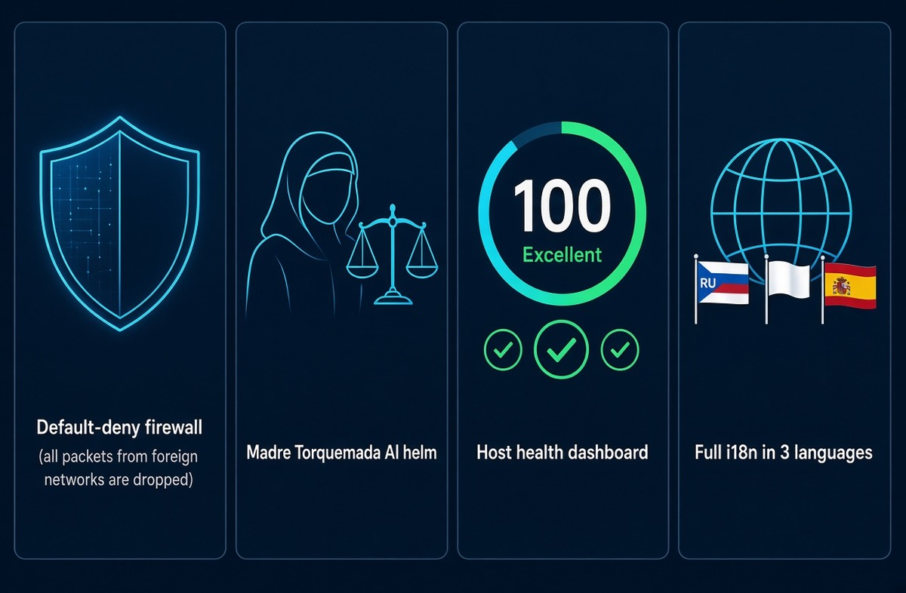

| Модуль | Что делает |
|---|---|
| **Default-deny firewall (Madre)** | Исходящий трафик разрешён только allowlist-своим; чужие пакеты дропаются на уровне `nftables` |
| **Honeypot** | Ловушки на 22/2222/3389/8080/8443/9200 — все подключения чужих логирование в `madre.db` |
| **Watchdog** | Сканирует `ss -tunap` на C2-порты вне своих сетей → событие `watchdog` |
| **RDP/VNC (MRC)** | Удалённые десктоп-сессии, передача файлов, чат, мульти-админ |
| **RAT (DRS)** | Безсессионные команды: `hosts_*`, `rdesk_*`, `rat_*`, `netutil_*` |
| **Active Directory** | LDAP через `ldap3` — управление пользователями/группами/компьютерами |
| **Здоровье хостов** | Score 0–100: load, память, диск, упавшие службы + вердикт Матери |
| **SIEM + EDR** | Логи событий, CVE-сканирование установленных пакетов |
| **Voice** | TTS/STT из коробки (без дополнительной настройки) |
| **i18n** | Русский / English / Español, переключение в меню «Настройки» |

## 📦 Установка за одну команду

Никаких ISO — весь дистрибутив в репозитории:

```bash
git clone https://github.com/PerfectFriend/Torquemada-AGI-OS-420
cd TorquemadaAGI
bash SETUP.sh [--from-release]
```

`SETUP.sh` автоматически:
- проверяет окружение (`git`, `curl`, `jq`, `sudo`, `cargo`, `node`),
- собирает `w420` из исходников (или грузит из GitHub Releases),
- копирует фронтенд, sidecar-бинарники и иконки,
- настраивает **автозагрузку** (`.desktop` + `systemd --user`),
- по согласию запускает `root_setup.sh` (nftables base + narrow NOPASSWD sudo).

Подробно: [`SETUP.md`](SETUP.md).

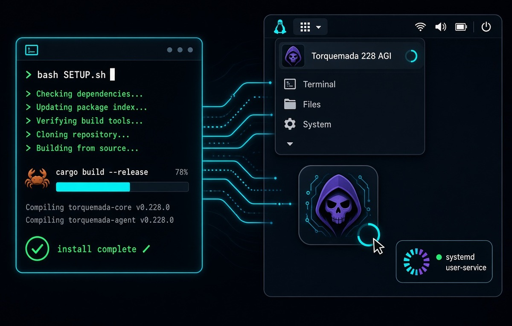

## 🎮 Первый запуск

```bash
~/.w420/opt/w420/w420    # или через меню «Торквемада 228 AGI»
```

Откроется голографический интерфейс — переключите язык в меню **Настройки** (RU/EN/ES).

## 🖥️ Скриншоты (десктопный режим)

| | | |
|---|---|---|
| 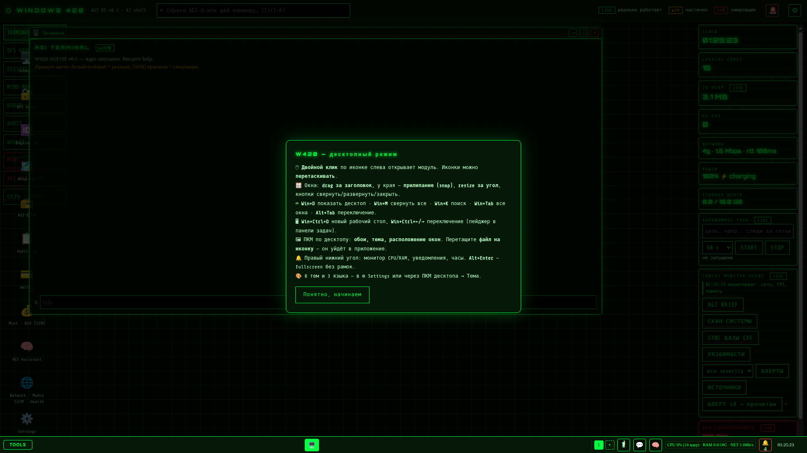 | 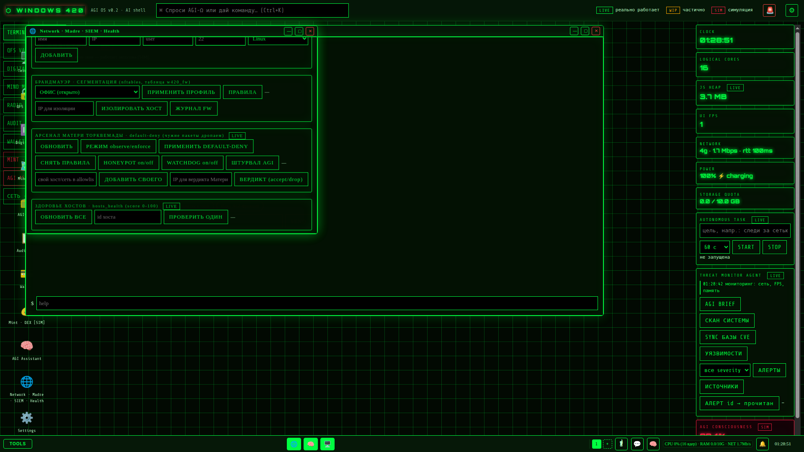 | 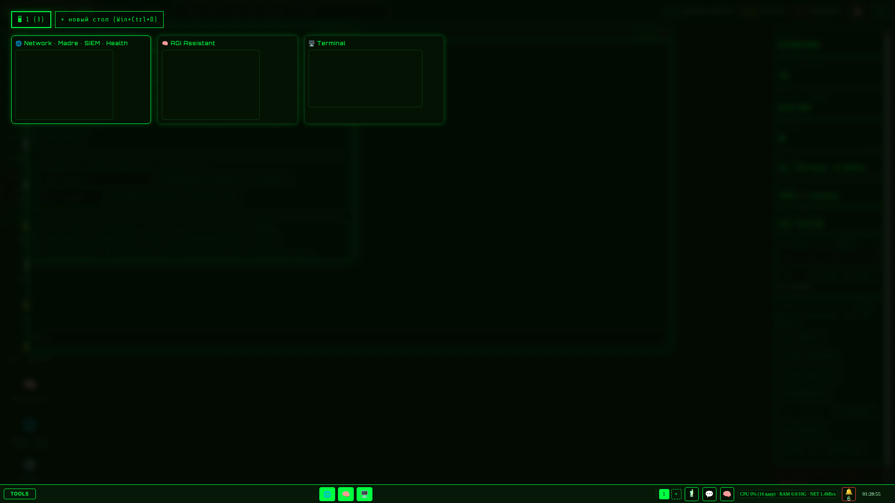 |
| Первый запуск с туториалом | Окна, иконки, taskbar с системным монитором | Task view (Win+Tab) и рабочие столы |
| 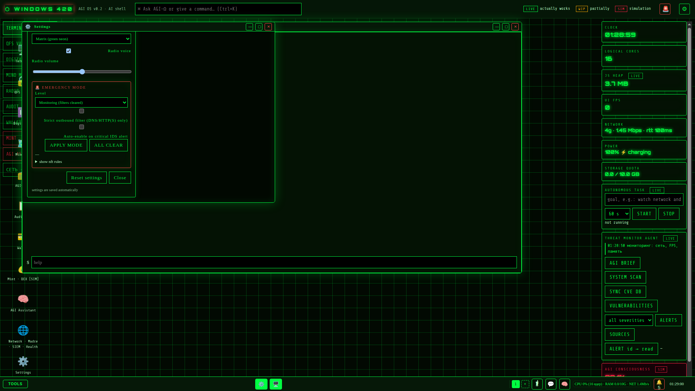 | 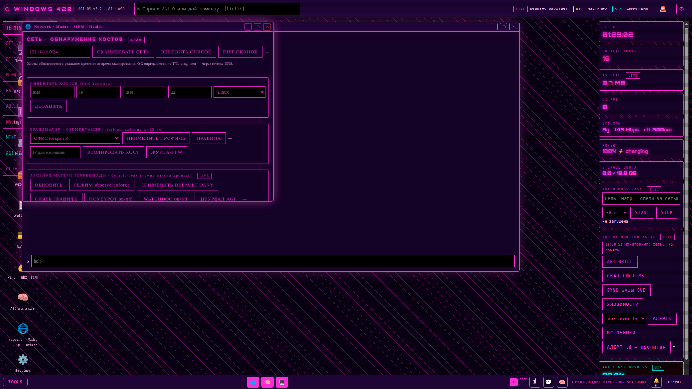 | 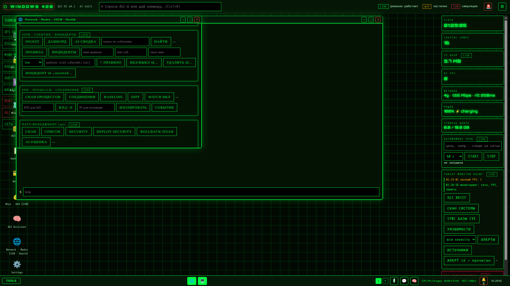 |
| Переключение языка RU/EN/ES | 8 тем оформления | Панель здоровья хоста |
| 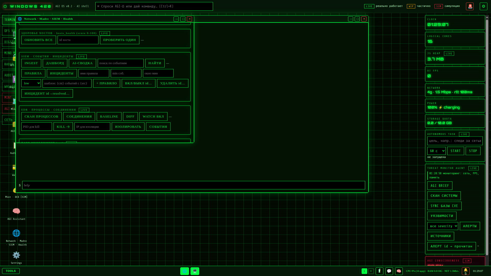 | 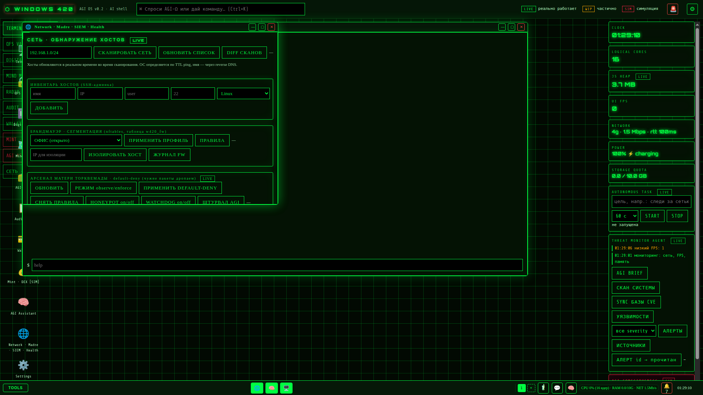 | |
| Firewall/honeypot | Alt+Enter — fullscreen без рамок | |

## 📊 Как это работает

[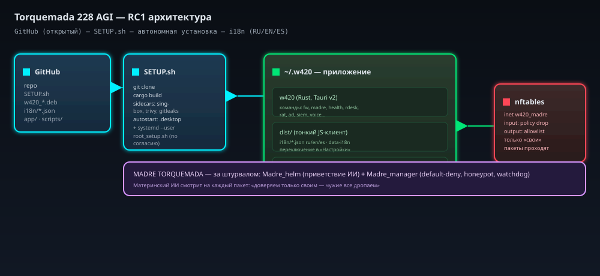](arch-rc1.svg) [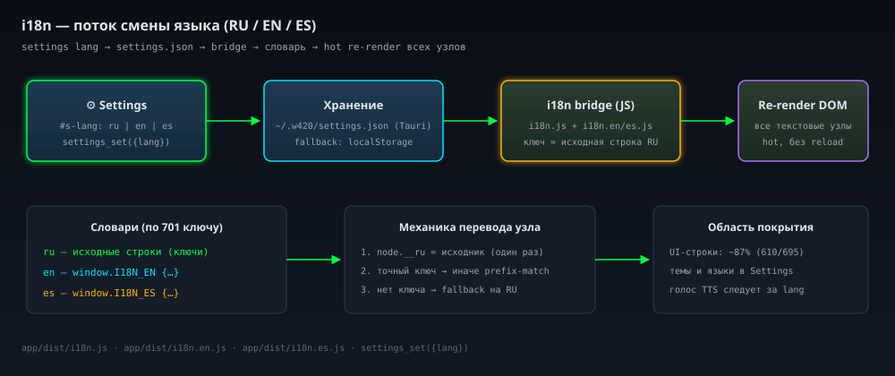](i18n-flow.svg) [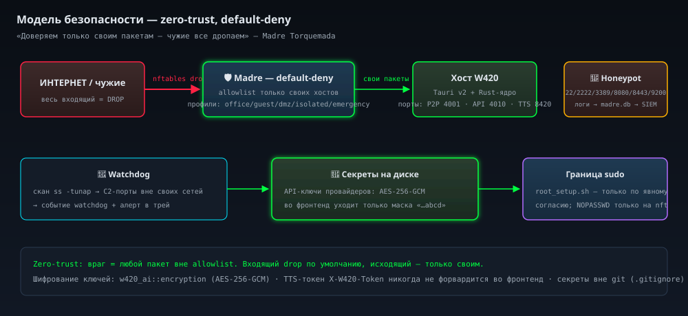](security-model.svg)

**Установка →** бинарник + тонкий клиент на `~/.w420` → **Rust-движок** вызывает sidecars (`sing-box`, `trivy`, `gitleaks`) и nftables → **Madre** смотрит каждый пакет.

## 🌍 Глобальная локализация

Все статические строки UI — в JSON-локалях: `app/dist/i18n.en.js` / `i18n.es.js` (ключ = исходная русская строка, словарь + MutationObserver). Переключатель в меню «Настройки» применяет язык мгновенно (голос TTS тоже учитывает `lang`).

## 🛡️ Безопасность

- API-ключи провайдеров шифруются на диске **AES-256-GCM**; наружу отдаётся только маска `…abcd` — ключи никогда не идут во фронтенд.
- Пароль sudo **никогда** не принимается приложением — root-шаг запускается пользователем от своего имени (`sudo bash root_setup.sh`), пароль вводится в его терминале.
- NVIDIA API-ключи загружаются из `~/Документы/ObsidianVault/LLM-API-KEYS.md`.
- Модель по умолчанию: Mistral Large 4 (`mistralai/mistral-large-4-1t-a52b`) на NVIDIA NIM.

## 📂 Структура репозитория

```
TorquemadaAGI/
├── app/src-tauri/src/          # Rust: AGI, Madre, firewall, RDP/VNC, RAT, AD, SIEM/EDR, voice, i18n
├── app/dist/                   # Тонкий JS-клиент (HTML/CSS + i18n JSON)
├── packaging/deb/              # .deb control + scripts/build_deb.sh
├── scripts/                    # root_setup.sh, w420-update.sh
├── RC1-PLAN.md                 # План RC1: SETUP.sh + i18n + автозагрузка
├── SETUP.md                    # Руководство по установке
├── SYSADMIN_GUIDE.md           # Руководство системного администратора
└── docs/                       # Истории, сценарии, отчёты по фазам
```

## 🗺️ Дорожная карта

План эволюции: [EVOLUTION_PLAN.md](EVOLUTION_PLAN.md) · Паритет DameWare: [DAMEWARE_PARITY_PLAN.md](DAMEWARE_PARITY_PLAN.md) · **RC1**: [RC1-PLAN.md](RC1-PLAN.md).

## 🤝 Вклад

MIT — fork, правьте, пул-реквесты приветствуются. Полный перечень лицензий сторонних компонентов: [`THIRD_PARTY_NOTICES.md`](THIRD_PARTY_NOTICES.md).

## 📄 Лицензия

[MIT License](LICENSE)
